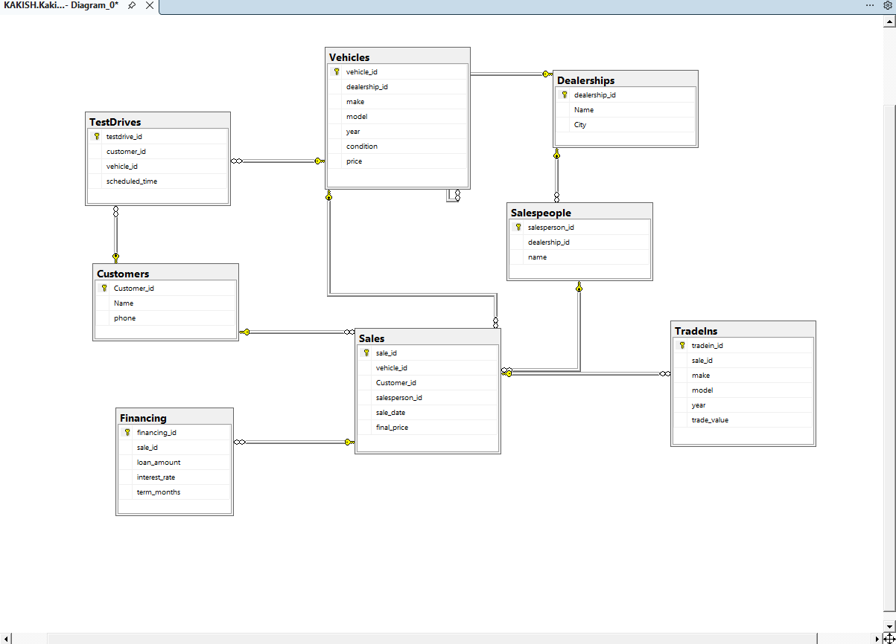
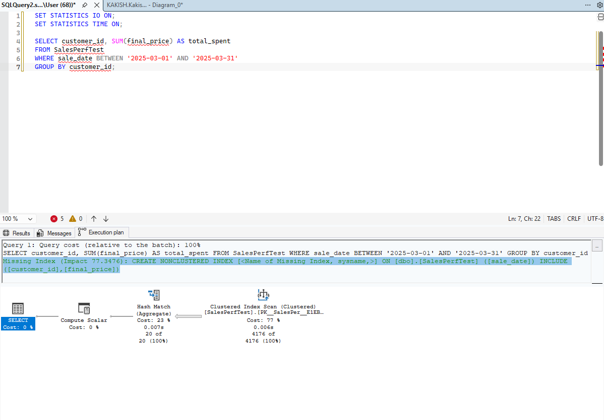
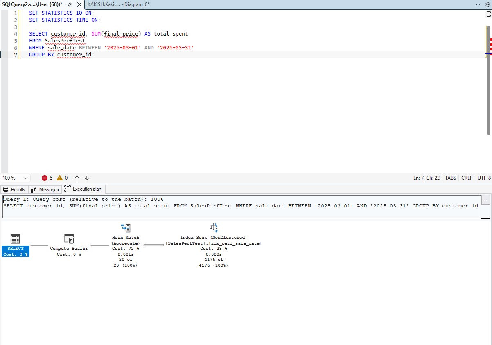
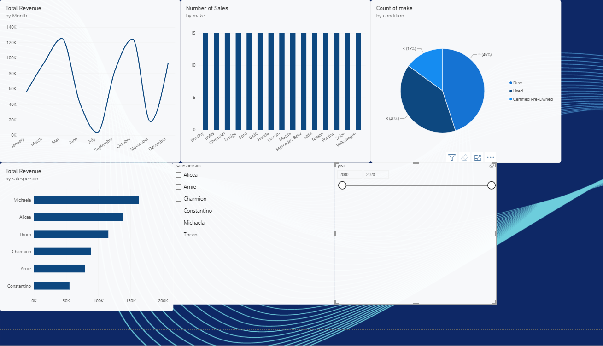

# KAKISH Automotives Database

A relational database for a fictional car dealership in Jordan, built in Microsoft SQL Server. I made it as my hands-on project while completing the Microsoft SQL Server Professional Certificate on Coursera. All the data is synthetic, so no real dealership, customers or sales are involved.

**Tools:** SQL Server (T-SQL), SQL Server Management Studio, Power BI, Mockaroo (to generate sample data)

## Schema



The database has 8 tables:

| Table | What it stores |
|---|---|
| Dealerships | The dealership branches |
| Customers | People who buy cars or book test drives |
| Vehicles | Cars in inventory (make, model, year, condition, price) |
| Salespeople | Staff, each tied to a dealership |
| Sales | Each sale, linking a customer, a vehicle and a salesperson |
| Financing | Loan details for sales that were financed |
| TradeIns | A customer's old car traded in as part of a sale |
| TestDrives | Scheduled test drives (customer and vehicle) |

How they relate:

- A dealership stocks many vehicles and employs many salespeople.
- A customer makes many sales and books many test drives.
- A vehicle is sold in at most one sale, and can have many test drives.
- A salesperson handles many sales.
- A sale may have one financing record and one trade-in. Cash sales have neither.

## What is in this repo

- `schema/` - CREATE TABLE statements for all 8 tables
- `queries/` - the queries I wrote against the data
- `performance/` - the indexing demo
- `programmability/` - a view, two stored procedures and a function
- `images/` - the ER diagram, execution plans and dashboard screenshot

## Query highlights

`queries/showcase_queries.sql` answers four business questions using joins, a window function, a CTE and a subquery:

- Revenue by car make
- Salesperson ranking, using `RANK()` as a window function
- Financed vs cash sales (`LEFT JOIN` with `CASE`)
- Customers who spent more than the average customer (CTE plus subquery)

Example, ranking salespeople by revenue:

```sql
SELECT sp.name, SUM(s.final_price) AS total_sales,
       RANK() OVER (ORDER BY SUM(s.final_price) DESC) AS sales_rank
FROM Sales s
JOIN Salespeople sp ON s.salesperson_id = sp.salesperson_id
GROUP BY sp.name;
```

## Performance

The Sales table only has 15 rows, so an index would not show any visible difference. To test indexing properly, I created a separate table called `SalesPerfTest` with 100,000 generated rows and ran this query:

```sql
SELECT customer_id, SUM(final_price) AS total_spent
FROM SalesPerfTest
WHERE sale_date BETWEEN '2025-03-01' AND '2025-03-31'
GROUP BY customer_id;
```

Then I added an index on the date column:

```sql
CREATE NONCLUSTERED INDEX idx_perf_sale_date
ON SalesPerfTest (sale_date)
INCLUDE (customer_id, final_price);
```

Before the index, SQL Server had to scan the whole table (a Clustered Index Scan), and the execution plan itself suggested the missing index. After I created it, the same query used an Index Seek on the new index and jumped straight to the March rows. The query returns the same 4,176 rows either way, so only the work SQL Server does to find them changed.

| Before the index | After the index |
|---|---|
|  |  |

## Views, procedures and a function

- `vw_SalesDetail` - a view joining each sale with its customer, vehicle and salesperson (the dashboard reads from it)
- `GetMonthlySales` - stored procedure returning revenue per month
- `GetSalesBySalesperson` - stored procedure that takes a salesperson ID
- `GetCustomerTotalSpend` - function returning how much a customer has spent

## Dashboard



A Power BI dashboard connected to the database. It shows total revenue, number of sales, average sale, revenue by month, revenue by salesperson, sales by make, and inventory by condition, with slicers for salesperson and year. The data is synthetic and randomly dated, so the monthly chart is uneven.

## Problems I solved

1. **Joins that returned no rows.** My join queries ran without errors but came back empty. I checked the Sales table with `SELECT DISTINCT` and found the foreign key columns were all NULL, because they were not filled during the data load. I fixed it with UPDATE statements, then added NOT NULL constraints so it cannot happen again.
2. **Foreign keys and Mockaroo.** Mockaroo does not know which IDs exist in my database, so it cannot generate valid foreign keys. I generated only the content columns with Mockaroo and set the keys with SQL afterwards.
3. **Loading data into existing tables.** The Import Flat File wizard always creates a new table. I imported each CSV into a staging table, copied the rows into the real table with `INSERT ... SELECT`, then dropped the staging table.

## How to run it

1. Create a database in SQL Server.
2. Run `schema/create_tables.sql`.
3. Add sample data. Mine was generated with Mockaroo and loaded through staging tables, so this repo does not include a data script.
4. Run the files in `queries/`, then `performance/` and `programmability/`.

## What I would add next

- A listing date on vehicles, to measure how long cars sit in inventory
- More than one dealership, each with its own sales
- A proper date table for time analysis

## About me

Built by Elias Kakish, a Data Science and AI student at Al Hussein Technical University in Jordan.

LinkedIn: [linkedin.com/in/elias-kakish-6471153a6](https://www.linkedin.com/in/elias-kakish-6471153a6)
